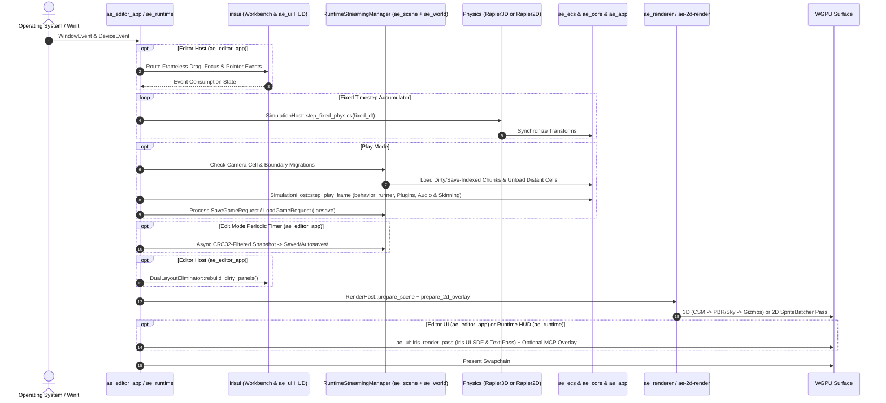

# Aeon Engine Architecture

This document describes the workspace crate topology, binary world and asset persistence formats, execution lifecycle, and engineering invariants of Aeon Engine and the Iris UI framework.

---

## 1. Architectural Principles

1. **Memory Safety (`unsafe_code = "forbid"`):**  
   Workspace crates enforce `unsafe_code = "forbid"` via `[workspace.lints.rust]`. Dynamic shared-library loading (`libloading`) is confined to `ae_plugin_host` and `cdylib` FFI entrypoints to `game_logic`. Static export builds (`ae_runtime --features static-game-logic`) link gameplay code statically with no dynamic symbol loading.

2. **Unidirectional Dependency Flow & Backend Isolation:**  
   Cycles between engine subsystems are disallowed. Foundation crates (`ae_ecs`, `ae_plugin_api`, `ae_core`, `ae_world`) have no dependency on rendering, editor, or application host crates. The external ECS storage backend (`hecs`) is encapsulated behind `crates/ae_ecs`.

3. **Engine vs. Iris UI Separation:**  
   `irisui` is a standalone retained-mode UI framework residing under `crates/irisui/` so it can share the workspace during engine development while remaining independently publishable to `crates.io`. It has zero dependencies on `ae_ecs`, `ae_core`, or any `ae_*` engine crate. Engine editor panels (`ae_editor_ui`) and runtime overlays (`ae_ui`) consume `irisui` solely through its public API.

4. **Decoupled Scene, App & Host Layers (`ae_scene` & `ae_app` vs. `ae_runtime` & `ae_editor_app`):**  
   UI-free scene lifecycle responsibilities (`serialization`, `loader`, `streaming::RuntimeStreamingManager`, `.aeprefab` `Prefab`, `EditorAutosaveState`, entity `spawning`, `asset_spawning`, `components`, `builtin_components`, and `migrate_ae_scene`) live in `ae_scene` without depending on `ae_editor`, `irisui`, or `rfd`. Transform math, TRS composition/decomposition, `cgmath <-> glam` interop, hierarchy propagation, keep-world reparenting, and `SpatialGrid` live in `ae_transform`. Headless application orchestration (`AeApp`, `AppPhase`, `AppSchedule`, `AppPlugin`, `PluginRegistry`, `PluginGroup`, `PluginGroupBuilder`, `DefaultCorePlugins`, `CoreWorld`, `NonSendResources`, `RenderHost`, `SimulationHost`, `behavior_runner`, `simulation`) resides in `ae_app` with no `winit`, `ae_editor*`, `irisui`, `rfd`, `ae_export`, or `ae_mcp` dependencies and composable Cargo feature gates (`--no-default-features`, `gameplay`, `state`, `physics`, `audio`, `animation`, `plugins`, `2d`, `ui`, `rendering`, `scene`). `ae_renderer` operates through `RenderSurfaceSize`, `wgpu::SurfaceTarget<'static>`, and `UiRenderCallback` with zero `winit`, `irisui`, or `gltf` dependencies, while `irisui` WGPU pass orchestration (`iris_render_pass`) lives in `ae_ui` (zero `ae_renderer` / `winit`). `ae_runtime` (`world_loader`, `static_plugin`) packages the editor-free standalone player on top of `ae_app` and `ae_ui`, while `ae_editor_app` (`EditorSession`) composes `ae_app`, `ae_editor`, `ae_editor_ui`, `ae_export`, and `ae_mcp` as the desktop studio host (`EditorWindowState::window: Arc<Window>`).

5. **Data-Driven Type Identification:**  
   Subsystem dispatch and ECS serialization rely on deterministic 64-bit FNV-1a type hashes (`component_type_hash`), 128-bit persistent GUIDs (`EntityGuid`, `AssetGuid`), strongly typed enums, and numeric properties rather than string matching heuristics.

---

## 2. Workspace Dependency Topology

The workspace comprises 50 modular crates organized into six architectural layers (solid arrows `-->` denote unconditional workspace dependencies; dashed arrows `-. feature .->` on `ae_app` and `ae_editor_app` / `ae_runtime` denote feature-gated optional dependencies):

```mermaid
graph TD
    subgraph Foundation["Foundation, ECS & Persistence Layer"]
        ae_ecs["ae_ecs (Backend-Isolated ECS & ComponentRegistry)"] --> ae_plugin_api["ae_plugin_api (GUIDs, POD Components, Plugin FFI ABI)"]
        ae_camera["ae_camera (Camera, Projections, Frustum, CameraUniform, ViewportRect)"]
        ae_camera --> ae_light["ae_light (Light, Shadow/Sky Tiers, CSM Cascade Math, Atmosphere/Fog, Uniforms; Zero wgpu)"]
        ae_light --> ae_plugin_api
        ae_camera --> ae_camera_controller["ae_camera_controller (Free-Fly, Pan/Zoom, Focus, Follow/Orbit)"]
        ae_ecs --> ae_camera_controller
        ae_plugin_api --> ae_camera_controller
        ae_ecs --> ae_core["ae_core (Resources, DynamicEventBus, EngineMode, EngineModule, Behavior; Zero winit/cgmath/glam)"]
        ae_plugin_api --> ae_core
        ae_ecs --> ae_state["ae_state (GameState, StateManager, StateTransition)"]
        ae_plugin_api --> ae_state
        ae_time["ae_time (Time, Fixed-Timestep Accumulator, FramePacer; Zero External Deps)"]
        ae_diagnostic["ae_diagnostic (Profiler, FrameRingBuffer, Timings, DrawCallBreakdown, VramStats)"]
        ae_ecs --> ae_transform["ae_transform (TRS Matrix, Conversions, Hierarchy, Reparent, SpatialGrid)"]
        ae_plugin_api --> ae_transform
        ae_input["ae_input (InputManager, ActionMap, AxisBinding, KeyCode, MouseButton)"]
        ae_plugin_api --> ae_world["ae_world (.aeworld, .aechunk, .aepak, .aesave, VFS, Cooked)"]
        ae_ecs --> ae_plugin_host["ae_plugin_host (Hot-Reload FFI Loader)"]
        ae_plugin_api --> ae_plugin_host
        ae_ecs --> game_logic["game_logic (cdylib + rlib)"]
        ae_plugin_api --> game_logic
        ae_plugin_api --> ae_texture["ae_texture (CPU Pixel/Mip Decoding & VFS Loaders)"]
        ae_world --> ae_texture
        ae_plugin_api --> ae_audio["ae_audio (Spatial 3D Audio & CookedAudio)"]
        ae_ecs --> ae_audio
        ae_world --> ae_audio
        ae_ecs --> ae_uidesign["ae_uidesign (In-Game UI Design Schema)"]
        ae_plugin_api --> ae_uidesign
    end

    subgraph Pipeline3D["3D Engine, Gizmos, Assets & Scene Layer"]
        ae_core --> ae_physics["ae_physics (Rapier3D & KCC)"]
        ae_ecs --> ae_physics
        ae_plugin_api --> ae_physics
        ae_transform --> ae_physics
        ae_animation["ae_animation (3D Skeletal Animation Data)"] --> ae_mesh["ae_mesh (Vertex, Submesh, Primitives, Skinning, Bounds, glTF 2.0; Zero wgpu)"]
        ae_texture --> ae_mesh
        ae_camera --> ae_gizmos["ae_gizmos (TransformGizmo, DebugShapes, Billboard Data, Compass; Zero wgpu)"]
        ae_camera --> ae_pbr["ae_pbr (PBR, CSM GPU Shadow, Sky, Grid, Sprite Pipelines, SceneUniforms, Vertex/Instance)"]
        ae_light --> ae_pbr
        ae_mesh --> ae_pbr
        ae_plugin_api --> ae_pbr
        ae_post_process["ae_post_process (Bloom, Tonemapping, MSAA Targets, Selection Outline)"]
        ae_camera --> ae_renderer["ae_renderer (AeonGPU Core, AssetManager, GeometrySystem, FloatingOrigin, Frame Orchestration; Zero winit/irisui/gltf)"]
        ae_diagnostic --> ae_renderer
        ae_light --> ae_renderer
        ae_mesh --> ae_renderer
        ae_pbr --> ae_renderer
        ae_post_process --> ae_renderer
        ae_transform --> ae_renderer
        ae_ecs --> ae_renderer
        ae_core --> ae_renderer
        ae_plugin_api --> ae_renderer
        ae_texture --> ae_renderer
        ae_animation --> ae_renderer
        ae_world --> ae_renderer
        ae_gizmos --> ae_gizmos_render["ae_gizmos_render (GizmoRenderer, DebugRenderer, BillboardSystem)"]
        ae_ecs --> ae_gizmos_render
        ae_light --> ae_gizmos_render
        ae_plugin_api --> ae_gizmos_render
        ae_renderer --> ae_gizmos_render
        ae_transform --> ae_gizmos_render
        ae_audio --> ae_gizmos_render
        ae_core --> ae_assets["ae_assets (Scanner, File Ops, Ingestion, Thumbnails, Pipeline)"]
        ae_mesh --> ae_assets
        ae_plugin_api --> ae_assets
        ae_renderer --> ae_assets
        ae_texture --> ae_assets
        ae_world --> ae_assets
    end

    subgraph Pipeline2D["2D Engine Subsystem (ae_2d)"]
        ae_camera --> ae_2d_core["ae-2d-core (2D Camera, Transform, Sorting)"]
        ae_ecs --> ae_2d_core
        ae_plugin_api --> ae_2d_core
        ae_2d_core --> ae_2d_render["ae-2d-render (Instanced Sprite Batcher)"]
        ae_2d_physics["ae-2d-physics (Rapier2D Simulation)"]
        ae_2d_anim["ae-2d-animation (Flipbook & Sprite Sheet)"]
        ae_2d_core --> ae_2d["ae_2d (Unified 2D Facade)"]
        ae_2d_render --> ae_2d
        ae_2d_physics --> ae_2d
        ae_2d_anim --> ae_2d
        ae_camera --> ae_2d
        ae_ecs --> ae_2d
        ae_plugin_api --> ae_2d
        ae_renderer --> ae_2d
        ae_texture --> ae_2d
        ae_transform --> ae_2d
    end

    subgraph SceneLayer["Unified Scene Lifecycle Layer"]
        ae_assets --> ae_scene["ae_scene (World I/O, Streaming, Prefab, Autosave, Spawning, Component Ops)"]
        ae_transform --> ae_scene
        ae_mesh --> ae_scene
        ae_world --> ae_scene
        ae_renderer --> ae_scene
        ae_light --> ae_scene
        ae_audio --> ae_scene
        ae_animation --> ae_scene
        ae_2d --> ae_scene
    end

    subgraph IrisUI_Framework["Iris UI Framework (crates/irisui)"]
        iris_core["irisui-core"] --> iris_layout["irisui-layout"]
        iris_core --> iris_text["irisui-text"]
        iris_core --> iris_wgpu["irisui-wgpu"]
        iris_text --> iris_wgpu
        iris_core --> iris_widgets["irisui-widgets (clipboard-os)"]
        iris_layout --> iris_widgets
        iris_text --> iris_widgets
        iris_wgpu --> iris_widgets
        iris_widgets --> iris_dock["irisui-dock"]
        iris_widgets --> iris_winit["irisui-winit"]
        iris_dock --> iris_workbench["irisui-workbench"]
        iris_winit --> iris_workbench
        iris_wgpu --> iris_workbench
        iris_workbench --> irisui["irisui (Top-Level Facade)"]
    end

    subgraph Tooling["Export, Inspection & Project Management"]
        ae_mesh --> ae_export["ae_export (Cooker, .aepak Packer & Standalone Bundler; Zero wgpu)"]
        ae_texture --> ae_export
        ae_audio --> ae_export
        ae_world --> ae_export
        irisui --> ae_mcp["ae_mcp (Inspect Server & Overlay)"]
        ae_world --> ae_launcher["ae_launcher (Project Hub)"]
        irisui --> ae_launcher
    end

    subgraph Runtime_And_Hosts["App Core, Runtime & Application Hosts"]
        ae_core --> ae_ui["ae_ui (In-Game UI Layout, HUD State, Pause Menu, RuntimeHudOverlay, iris_render_pass; Zero winit/ae_renderer)"]
        ae_ecs --> ae_ui
        ae_plugin_api --> ae_ui
        ae_state --> ae_ui
        iris_widgets --> ae_ui
        iris_wgpu --> ae_ui

        ae_core --> ae_app["ae_app (AeApp, Schedules, PluginGroup, CoreWorld, NonSendResources, RenderHost, SimulationHost, BehaviorRunner; Zero winit/irisui)"]
        ae_ecs --> ae_app
        ae_input --> ae_app
        ae_plugin_api --> ae_app
        ae_time --> ae_app
        ae_world --> ae_app
        ae_scene -. "scene" .-> ae_app
        ae_ui -. "ui" .-> ae_app
        ae_state -. "state" .-> ae_app
        ae_camera -. "rendering/physics/audio" .-> ae_app
        ae_camera_controller -. "gameplay" .-> ae_app
        ae_physics -. "physics" .-> ae_app
        ae_audio -. "audio" .-> ae_app
        ae_plugin_host -. "plugins" .-> ae_app
        ae_transform -. "rendering/physics" .-> ae_app
        ae_renderer -. "rendering" .-> ae_app
        ae_light -. "rendering" .-> ae_app
        ae_animation -. "animation" .-> ae_app
        ae_2d -. "2d" .-> ae_app

        ae_app --> ae_runtime["ae_runtime (Editor-Free Standalone Player Executable; Zero irisui/ae_editor)"]
        ae_ui --> ae_runtime
        ae_scene --> ae_runtime
        ae_plugin_host --> ae_runtime
        game_logic -. "static-game-logic" .-> ae_runtime

        ae_camera --> ae_editor["ae_editor (Picking, Selection, Snapping, Undo/Redo, Ground Drop, Session Helpers; Zero wgpu/winit/ae_renderer)"]
        ae_camera_controller --> ae_editor
        ae_gizmos --> ae_editor
        ae_input --> ae_editor
        ae_light --> ae_editor
        ae_transform --> ae_editor
        ae_ecs --> ae_editor
        ae_core --> ae_editor
        ae_plugin_api --> ae_editor

        ae_editor --> ae_editor_ui["ae_editor_ui (Pure Declarative IDE Views & EngineUiAction)"]
        ae_camera --> ae_editor_ui
        ae_gizmos --> ae_editor_ui
        ae_export --> ae_editor_ui
        ae_ui --> ae_editor_ui
        ae_diagnostic --> ae_editor_ui
        ae_assets --> ae_editor_ui
        ae_scene --> ae_editor_ui
        ae_renderer --> ae_editor_ui
        ae_uidesign --> ae_editor_ui
        irisui --> ae_editor_ui
        iris_winit --> ae_editor_ui

        ae_app --> ae_editor_app["ae_editor_app (Desktop Studio IDE Executable & EditorSession)"]
        ae_diagnostic --> ae_editor_app
        ae_gizmos_render --> ae_editor_app
        ae_export --> ae_editor_app
        ae_editor --> ae_editor_app
        ae_editor_ui --> ae_editor_app
        ae_uidesign --> ae_editor_app
        ae_assets --> ae_editor_app
        ae_scene --> ae_editor_app
        ae_renderer --> ae_editor_app
        irisui --> ae_editor_app
        ae_mcp -. "mcp" .-> ae_editor_app
    end
```



---

## 3. Binary Data Architecture & Modular Project Tree

Every project initialized by `ae_launcher` or opened via `--project` follows a partitioned directory layout managed by `ae_world::ProjectWorkspaceLayout`:

```txt
<ProjectRoot>/
 ├── aeon_project.json           # Project metadata, entry world, active dimension mode
 ├── Config/                     # Render, physics, and input binding profiles
 ├── Content/                    # Source assets (.glb, .png, .wav, .wgsl, .aeprefab + .aemeta [AssetGuid])
 ├── Worlds/
 │    └── MainWorld/
 │         ├── world.aeworld     # Light manifest: header, string/asset pools, global entities, cell index
 │         └── cells/
 │              ├── 0_0_0.aechunk
 │              └── -1_0_2.aechunk  # Independent LZ4+CRC32 spatial cells (parallel dirty-only writes)
 ├── Intermediate/               # Platform-keyed cooked cache (<desktop|android>/<asset_hash>.<ext>)
 └── Saved/
      ├── Autosaves/             # Rotating background Edit-mode snapshots (*_autosave_{0..2}.aeworld)
      ├── Logs/                  # Session logs
      └── SaveGames/             # Runtime player slot_<id>.aesave (+ .bak recovery)
```

### Binary Containers (`crates/ae_world`):
* **`.aeworld` / `.aechunk`:** Envelope headers with magic signatures (`AEWLD001`, `AECHK001`), IEEE CRC32 validation, `postcard` component payloads keyed by FNV-1a 64-bit type hashes, and `lz4_flex` per-chunk compression written in parallel via `rayon`.
* **`.aepak` (`AEPAK001`):** Random-access 64 KiB block-compressed archive with `PAK_BLOCK_ALIGNMENT = 16` offsets and `AlignedBuffer` (`Vec<[u8; 16]>`) backing for safe zero-copy `bytemuck::try_cast_slice` uploads.
* **`.aesave` (`AESAV001` v2):** Cell-indexed delta snapshots (`global_delta` + `BTreeMap<SpatialCellCoord, CellDelta>`) supporting $O(\log C)$ chunk streaming application, asymmetric cross-cell relocation (`relocate_entity`), and crash-safe `.tmp -> sync_all -> .bak -> rename` writes.
* **`.aemeta` (`AEMET001`) & Cooked Assets (`AECKM001`, `AECKT001`, `AECKA001`):** Persistent asset identity across disk moves (`AssetMeta`) and platform-profiled `CookedMesh` / `CookedTexture` / `CookedAudio` blobs.

---

## 4. Subsystem Breakdown

### 4.1. `ae_ecs`, `ae_plugin_api`, `ae_core` & `ae_plugin_host`
* **`ae_ecs`:** Encapsulates the workspace ECS backend (`hecs` isolated inside this single crate), exposing `World`, `Entity`, `EntityBuilder`, `EntityCommandBuffer`, `EcsQuery`, scoped `inspect`/`mutate` closures for conflict-free component access, `ComponentRegistry` (`ComponentHandler`, `TypedComponentHandler`), and FNV-1a `component_type_hash`.
* **`ae_plugin_api`:** Defines `EntityGuid`, `AssetGuid`, POD gameplay components (`LodGroup`, transform/physics/gameplay types), `engine_component_registry()`, `Resources`, `PluginContext` / `PluginContextFFI`, and standard events including `SaveGameRequest` / `LoadGameRequest` (`DynamicEventBus::{save_slot, load_slot}`).
* **`ae_core`, `ae_state`, `ae_time`, `ae_diagnostic`, `ae_transform`, `ae_ui`:** `ae_core` holds `DynamicEventBus`, `EngineMode`, `EngineModule`, and `Behavior` traits with zero `winit`/`cgmath`/`glam` dependencies. Pushdown `StateManager` lives in `ae_state`; frame clock & `FramePacer` live in `ae_time`; CPU/GPU profiler metrics live in `ae_diagnostic`; TRS matrices, `SpatialGrid`, and hierarchy propagation live in `ae_transform`; ECS HUD layout, `pause_menu`, `RuntimeHudOverlay`, and `iris_render_pass` live in `ae_ui` (zero `winit`, zero `ae_renderer`).
* **`ae_input`:** Input abstraction crate owning the three-state `InputManager` (`pressed`, `just_pressed`, `just_released`) for keyboard keys and mouse buttons alongside serializable `ActionMap` / `AxisBinding` (`Config/input.json`).
* **`ae_camera` & `ae_camera_controller`:** `ae_camera` (free of `wgpu`, `ae_core`, `ae_ecs`, `ae_world`) owns `Camera`, `ProjectionMode`, `PerspectiveProjection`, `OrthographicProjection`, `OPENGL_TO_WGPU_MATRIX`, `Frustum`, POD `CameraUniform`, and `ViewportRect`/`Viewport`; `ae_camera_controller` unifies free-fly WASD/QE navigation, orthographic pan/zoom, target focus, and Play-mode orbit/follow tracking.
* **`ae_plugin_host` & `game_logic`:** Supports hot-reloadable dynamic `cdylib` plugins in Editor workflows (`NativePluginBackend` via `libloading`) and dual `cdylib` + `rlib` compilation for static linkage in exported runtimes.

### 4.2. `ae_world` & `ae_assets`
* **`ae_world`:** Abstracts file access across editor folders (`DiskVfsProvider`), in-memory bundles (`PakMemoryVfsProvider`), file-backed archives (`PakFileVfsProvider`), and layered mount stacks (`CompositeVfs`), plus `CellStreamingPlanner` (cubic hysteresis streaming), `PendingGuidResolver`, `AlignedBuffer`, and `CookedMesh`/`CookedTexture`/`CookedAudio`.
* **`ae_assets`:** Headless, UI-free asset subsystem owning directory scanning (`scanner`), safe filesystem operations (`file_ops`), glTF dependency copy & URI decoding (`ingestion`), software 64x64 RGBA thumbnails (`thumbnails`), background `rayon` glTF/`FBX2glTF` import pipelines (`pipeline`), and parallel `.aeworld` asset parsing (`scene_assets`).

### 4.3. `ae_scene`, `ae_app` & `ae_runtime`
* **`ae_scene`:** UI-free, editor-free scene lifecycle crate unifying world capture & CRC32 dirty-chunk saving (`serialization`), async & VFS `.aeworld` decoding (`loader` + unified `spawn_world_records`), `RuntimeStreamingManager` (`streaming`), LZ4+CRC32 binary prefabs (`prefab`), Edit-mode background auto-save (`autosave`), pure ECS spawning (`spawning`), asset prefab/model instantiation (`asset_spawning`), ECS component/material/LOD operations (`components`), starter defaults (`defaults`), authoritative 31-component catalog (`builtin_components`), and the `migrate_ae_scene` CLI tool.
* **`ae_app`:** Headless application host and lifecycle layer (zero `winit`, `ae_editor*`, `irisui`, `rfd`, `ae_export`, `ae_mcp`) providing `AppPhase`/`AppSchedule`, `AppPlugin`/`PluginRegistry`, `PluginGroup`/`PluginGroupBuilder`, subsystem plugins (`PhysicsPlugin`, `AudioPlugin`, `StatePlugin`, `ScriptingPlugin`, `HudPlugin`, `DefaultCorePlugins`), `AeApp`, `CoreWorld` (including thread-local `!Send` host storage via `NonSendResources`), `RenderHost` (shared `prepare_scene` + `prepare_2d_overlay`), `SimulationHost` (unified `step_fixed_physics` + `step_play_frame`), `behavior_runner`, and `simulation`. Optional subsystems are gated behind Cargo features (`default = ["gameplay", "2d"]`, plus `--no-default-features` with `gameplay`, `physics`, `audio`, `animation`, `plugins`, `state`, `2d`, `ui`, `rendering`, and `scene`).
* **`ae_runtime`:** Standalone editor-free desktop player executable (`world_loader`, `static_plugin`, `app`, `--pak`, `--world`, `--save-dir`, neighboring `game.aepak`, or embedded pak bytes) layered directly on `ae_app` and `ae_ui`.

### 4.4. `ae_physics` & `ae_audio`
* **`ae_physics`:** Wraps Rapier3D with retained collider scale mapping (`entity_to_collider_scale`), kinematic character control (KCC), and collision/trigger event emission.
* **`ae_audio`:** Spatial 3D audio mixing via `rodio`, reading directly from `VfsProvider` byte streams or zero-parse `CookedAudio` PCM buffers.

### 4.5. `ae_renderer`, `ae_mesh`, `ae_texture`, `ae_gizmos` & `ae_gizmos_render`
* **`ae_mesh`:** GPU-free 3D geometry crate (zero `wgpu`) owning POD `Vertex`/`SpriteVertex`/`SkinVertex`, `SubmeshAlphaMode`/`ModelSubmesh`, `ParsedModelData`, `compute_aabb_bounding_radius`, `apply_skinning_palette`, static/procedural primitives (`CUBE_VERTICES`, `PYRAMID_VERTICES`, `generate_sphere`/`cylinder`/`capsule`/`torus`), and glTF 2.0 parsing.
* **`ae_texture`:** CPU pixel/mipmap decoding and VFS/GUID loading (`parse_texture_bytes`, `load_texture_from_vfs`, `CookedTexture` conversion).
* **`ae_renderer`:** WGPU forward PBR pipeline (4-cascade CSM shadows, sky atmosphere, MSAA/post-process, GPU `GeometrySystem` & `ModelAsset` upload, `FloatingOrigin` double-precision camera offset helpers, `AssetManager` chunk reference counting, and VFS loaders). Operates through `RenderSurfaceSize`, `wgpu::SurfaceTarget<'static>`, and `UiRenderCallback` with zero `winit`, `irisui`, or `gltf` dependencies.
* **`ae_gizmos`:** GPU-independent gizmo crate (`TransformGizmo` interaction/math/picking/geometry, collider wireframe generators `DebugShapes`, `BillboardVertex`/`BillboardUniform`/`BillboardIconType`, and 3D viewport compass `SceneNavigationGizmo`/`SceneViewSnap`) with zero `wgpu` dependency.
* **`ae_gizmos_render`:** WGPU `OverlayRenderer` crate hosting `GizmoRenderer`, `DebugRenderer`, and `BillboardSystem`/`BillboardPipeline` alongside `gizmo.wgsl`, `debug_line.wgsl`, and `billboard.wgsl`.

### 4.6. `ae_2d` (Decoupled 2D Subsystem)
Five-crate 2D suite (`ae-2d-core`, `ae-2d-render`, standalone `ae-2d-physics`, standalone `ae-2d-animation`, unified facade `ae_2d`) operating under `ActiveDimensionMode::Mode2D`, bypassing 3D PBR/Rapier3D when 2D mode is active.

### 4.7. Iris UI Framework (`crates/irisui/*`), `ae_editor` & `ae_editor_ui`
`irisui` is a standalone, GPU-accelerated retained-mode UI framework developed inside `crates/irisui/` and structured for independent publishing to `crates.io`. It carries zero dependencies on `ae_ecs`, `ae_core`, or any engine crate, and powers both desktop tooling (`ae_editor_app`, `ae_launcher`, `ae_mcp`) and in-game HUD overlays (`ae_ui::iris_render_pass` in both editor Play mode and `ae_runtime`):

| Crate | Scope |
| :--- | :--- |
| `irisui-core` | Safe arena node graph, geometry primitives, and styling/theme data structures |
| `irisui-layout` | `taffy`-backed flexbox/grid layout engine adapter and subtree caching |
| `irisui-text` | GPU typography, font shaping, and glyph caching via `glyphon` / `cosmic-text` |
| `irisui-wgpu` | GPU SDF rendering pipeline (analytic rounded quads, shadows, nested scissor stack) |
| `irisui-widgets` | Declarative `UiScope` widget set, virtual lists/trees/tables/grids, dialogs, and optional OS clipboard (`clipboard-os` isolating `arboard` off mobile targets) |
| `irisui-dock` | Binary split-tree docking and multi-pane tab management |
| `irisui-winit` | Platform windowing adapter, `WindowDragHost`, and 8-directional border resizing (`FramelessWindowHost`) |
| `irisui-workbench` | Desktop application workbench shell, menubar/statusbar chrome, panel registry, and $O(M)$ partial layout invalidation (`DualLayoutEliminator`) |
| `irisui` | Top-level facade crate re-exporting all Iris UI subsystems |

* **`ae_editor` & `ae_editor_ui`:** `ae_editor` (free of `wgpu`, `winit`, and `ae_renderer`) owns raycast/ground picking (`picking::resolve_ground_drop_world_pos`), selection, grid snapping, Play/Spawn command helpers (`actions`), and Undo/Redo snapshots; `ae_editor_ui` defines declarative `UiScope` panel views and emits typed `EngineUiAction` commands to `ae_editor_app` without mutating engine state directly.

### 4.8. `ae_mcp`, `ae_export`, `ae_launcher` & `ae_editor_app`
* **`ae_mcp`:** Live UI tree inspection server (`ae_mcp_server`) and visual feedback overlay attached optionally via `ae_editor_app --inspect <HOST:PORT>` (`feature = "mcp"`).
* **`ae_export`:** Dependency graph scanner (`dependency_graph`), parallel `Intermediate/<target>/` cooker (`CookedMesh`, `CookedTexture`, `CookedAudio`), `16`-byte aligned `game.aepak` packer, and Linux/Windows `ae_runtime` standalone bundler (`ae_export_cli` + Editor `File -> Export Project...` modal).
* **`ae_launcher`:** Project hub creating and opening modular workspaces and launching `ae_editor_app`.
* **`ae_editor_app`:** Desktop studio IDE executable organized around cohesive `EditorSession` groups (`core: CoreWorld`, `render: RenderHost`, `sim: SimulationHost`, `editor`, `ui`, `gizmos: EditorGizmos`, `host_io: EditorHostIo`, `window: EditorWindowState` owning `window: Arc<Window>`), optional `rfd` dialogs (`feature = "editor-dialogs"`), Linux `jemallocator` isolation (`not(target_os = "android")`), host action dispatching (`actions`), input arbitration (`events`), and Edit-mode autosave coordination.

---

## 5. Execution Lifecycle (The Frame Highway)



---

## 6. Workspace Lint & Build Policies

* **Memory Safety:** `unsafe_code = "forbid"` is set via `[workspace.lints.rust]` across workspace crates. FFI dynamic loading and `cdylib` symbol exports are isolated to `ae_plugin_host` and `game_logic`, which inherit `[lints.clippy]` without `[workspace.lints.rust]`.
* **Static Analysis & Formatting:** `[workspace.lints.clippy]` denies `allow_attributes`, `clone_on_ref_ptr`, `disallowed_types`, `mem_forget`, `todo`, `unimplemented`, `dbg_macro`, `print_stdout`, `print_stderr`, `clone_on_copy`, and `redundant_clone`. Workspace formatting and lint cleanliness are checked with `cargo fmt --check` and `cargo clippy --workspace --all-targets -- -D warnings`.
* **Feature-Gate & Test Verification:** Full suite tests run via `cargo test --workspace`; modular decoupling is verified via `cargo check -p ae_app --no-default-features` (and feature subsets) plus `cargo check -p ae_runtime --features static-game-logic`.
