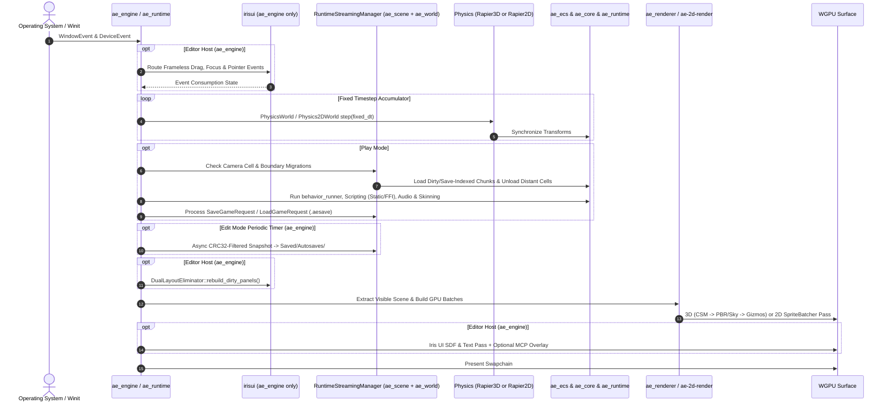

# Aeon Engine Architecture

This document describes the workspace crate topology, binary world and asset persistence formats, execution lifecycle, and engineering invariants of Aeon Engine and the Iris UI framework.

---

## 1. Architectural Principles

1. **Memory Safety Boundary (`unsafe_code = "forbid"`):**  
   Safe Rust crates inheriting `[workspace.lints.rust]` strictly enforce `unsafe_code = "forbid"`. Dynamic shared-library FFI interop (`libloading`) is isolated solely inside `ae_plugin_host`; exported runtime builds using `ae_runtime --features static-game-logic` link gameplay code statically with zero dynamic symbol resolution.

2. **Unidirectional Dependency Flow & Backend Isolation:**  
   Circular dependencies between engine subsystems are prohibited. Lower-level foundation crates (`ae_ecs`, `ae_plugin_api`, `ae_core`, `ae_world`) have zero awareness of rendering, editor UI, or application host layers. External ECS storage (`hecs`) is confined strictly inside `crates/ae_ecs`.

3. **Strict Domain Separation (Engine vs. Iris UI Framework):**  
   `irisui` is a standalone, desktop-grade retained UI framework structured for independent distribution. It maintains zero dependencies on `ae_ecs`, `ae_core`, or engine crates. `ae_editor_ui` operates exclusively as a declarative `UiScope` view consumer.

4. **Decoupled Scene & Simulation Layers (`ae_scene` & `ae_runtime` vs. `ae_engine` Editor Host):**  
   UI-free scene lifecycle responsibilities (`serialization`, `loader`, `streaming::RuntimeStreamingManager`, `.aeprefab` `Prefab`, `EditorAutosaveState`, entity `spawning`, and `migrate_ae_scene`) are consolidated inside `ae_scene` with zero dependencies on `ae_editor`, `irisui`, or `rfd`. Transform math, TRS composition/decomposition, `cgmath <-> glam` interop, hierarchy propagation, keep-world reparenting, and `SpatialGrid` live in `ae_transform`. Core gameplay execution (`behavior_runner`, `hud`, `world_loader`, `simulation`, `static_plugin`) resides in `ae_runtime` composing `ae_scene` and `ae_transform`. `ae_engine` composes `ae_scene`, `ae_runtime`, `ae_export`, `ae_editor_ui`, and `ae_mcp` as the top-level IDE host.

5. **Data-Driven & Explicit Type System:**  
   Subsystem decisions and ECS component serialization operate strictly on deterministic 64-bit type hashes (`component_type_hash`), 128-bit persistent GUIDs (`EntityGuid`, `AssetGuid`), strongly typed Rust enums, and mathematical quantities without string-based heuristics.

---

## 2. Workspace Dependency Topology

The workspace comprises modular crates organized into six architectural layers:

```mermaid
graph TD
    subgraph Foundation["Foundation, ECS & Persistence Layer"]
        ae_ecs["ae_ecs (Backend-Isolated ECS & ComponentRegistry)"] --> ae_plugin_api["ae_plugin_api (GUIDs, POD Components, Plugin FFI ABI)"]
        ae_camera["ae_camera (Camera, Projections, Frustum, CameraUniform, ViewportRect)"]
        ae_camera --> ae_camera_controller["ae_camera_controller (Free-Fly, Pan/Zoom, Focus, Follow/Orbit)"]
        ae_ecs --> ae_camera_controller
        ae_plugin_api --> ae_camera_controller
        ae_plugin_api --> ae_core["ae_core (Events, Time, Behaviors; Zero winit/cgmath/glam)"]
        ae_plugin_api --> ae_state["ae_state (GameState, StateManager, StateTransition)"]
        ae_ecs --> ae_state
        ae_diagnostic["ae_diagnostic (Profiler, FrameRingBuffer, Timings, DrawCallBreakdown, VramStats)"]
        ae_plugin_api --> ae_transform["ae_transform (TRS Matrix, Conversions, Hierarchy, Reparent, SpatialGrid)"]
        ae_ecs --> ae_transform
        ae_input["ae_input (InputManager, ActionMap, AxisBinding, KeyCode, MouseButton)"]
        ae_ecs --> ae_core
        ae_plugin_api --> ae_world["ae_world (.aeworld, .aechunk, .aepak, .aesave, VFS, Cooked)"]
        ae_plugin_api --> ae_plugin_host["ae_plugin_host (Hot-Reload FFI Loader)"]
        ae_plugin_api --> game_logic["game_logic (cdylib + rlib)"]
        ae_plugin_api --> ae_texture
        ae_world --> ae_texture
        ae_world --> ae_audio
        ae_plugin_api --> ae_uidesign
    end

    subgraph Pipeline3D["3D Engine, Gizmos, Assets & Scene Layer"]
        ae_core --> ae_physics["ae_physics (Rapier3D & KCC)"]
        ae_ecs --> ae_physics
        ae_core --> ae_animation["ae_animation (3D Skeletal)"]
        ae_ecs --> ae_animation
        ae_camera --> ae_gizmos["ae_gizmos (TransformGizmo, DebugShapes, Billboard Data, Compass)"]
        ae_camera --> ae_renderer
        ae_diagnostic --> ae_renderer["ae_renderer (AeonGPU, CSM, PBR, VFS, FloatingOrigin)"]
        ae_animation --> ae_renderer
        ae_world --> ae_renderer
        ae_ecs --> ae_renderer
        ae_camera --> ae_gizmos["ae_gizmos (TransformGizmo, DebugShapes, Billboard Data, Compass)"]
        ae_animation --> ae_mesh["ae_mesh (Vertex, Submesh, Primitives, Skinning, Bounds, glTF 2.0; Zero wgpu)"]
        ae_texture --> ae_mesh
        ae_mesh --> ae_renderer["ae_renderer (AeonGPU, CSM, PBR, VFS, FloatingOrigin)"]
        ae_camera --> ae_renderer
        ae_diagnostic --> ae_renderer
        ae_animation --> ae_renderer
        ae_world --> ae_renderer
        ae_ecs --> ae_renderer
        ae_gizmos --> ae_gizmos_render["ae_gizmos_render (GizmoRenderer, DebugRenderer, BillboardSystem)"]
        ae_renderer --> ae_gizmos_render
        ae_audio --> ae_gizmos_render
        ae_mesh --> ae_assets["ae_assets (Scanner, File Ops, Ingestion, Thumbnails, Pipeline)"]
        ae_renderer --> ae_assets
        ae_world --> ae_assets
        ae_core --> ae_assets
    end

    subgraph Pipeline2D["2D Engine Subsystem (ae_2d)"]
        ae_camera --> ae_2d_core["ae-2d-core (2D Camera, Transform, Sorting)"]
        ae_2d_core --> ae_2d_render["ae-2d-render (Instanced Sprite Batcher)"]
        ae_2d_core --> ae_2d_physics["ae-2d-physics (Rapier2D Simulation)"]
        ae_2d_core --> ae_2d_anim["ae-2d-animation (Flipbook & Sprite Sheet)"]
        ae_2d_render --> ae_2d["ae_2d (Unified 2D Facade)"]
        ae_2d_physics --> ae_2d
        ae_2d_anim --> ae_2d
    end

    subgraph SceneLayer["Unified Scene Lifecycle Layer"]
        ae_assets --> ae_scene["ae_scene (World I/O, Streaming, Prefab, Autosave, Spawning)"]
        ae_transform --> ae_scene
        ae_mesh --> ae_scene
        ae_world --> ae_scene
        ae_2d --> ae_scene
    end

    subgraph IrisUI_Framework["Iris UI Framework (crates/irisui)"]
        iris_core["irisui-core"] --> iris_layout["irisui-layout"]
        iris_layout --> iris_text["irisui-text"]
        iris_text --> iris_widgets["irisui-widgets (clipboard-os)"]
        iris_widgets --> iris_dock["irisui-dock"]
        iris_dock --> iris_workbench["irisui-workbench"]
        iris_workbench --> irisui["irisui (Top-Level Facade)"]
        iris_winit["irisui-winit"] --> irisui
        iris_wgpu["irisui-wgpu"] --> irisui
    end

    subgraph Tooling["Export, Inspection & Project Management"]
        ae_mesh --> ae_export["ae_export (Cooker, .aepak Packer & Standalone Bundler; Zero wgpu)"]
        ae_world --> ae_export
        irisui --> ae_mcp["ae_mcp (Inspect Server & Overlay)"]
        ae_world --> ae_launcher["ae_launcher (Project Hub)"]
        irisui --> ae_launcher
    end

    subgraph Runtime_And_Hosts["Runtime Core & Application Hosts"]
        ae_scene --> ae_runtime["ae_runtime (Editor-Free Player & Simulation Core; Zero irisui)"]
        ae_ui["ae_ui (In-Game UI Layout, HUD State, Pause Menu, RuntimeHudOverlay; Zero winit)"] --> ae_runtime
        ae_core --> ae_ui
        ae_state --> ae_ui
        ae_renderer --> ae_ui
        irisui --> ae_ui
        ae_state --> ae_runtime
        ae_camera --> ae_runtime
        ae_camera_controller --> ae_runtime
        ae_input --> ae_runtime
        ae_physics --> ae_runtime
        ae_audio --> ae_runtime
        ae_plugin_host --> ae_runtime

        ae_camera --> ae_editor["ae_editor (Picking, Selection, Snapping, Undo/Redo; Zero wgpu/winit)"]
        ae_camera_controller --> ae_editor
        ae_gizmos --> ae_editor
        ae_input --> ae_editor
        ae_transform --> ae_editor
        ae_ecs --> ae_editor
        ae_editor --> ae_editor_ui["ae_editor_ui (Pure Declarative IDE Views & EngineUiAction)"]
        ae_camera --> ae_editor_ui
        ae_gizmos --> ae_editor_ui
        ae_export --> ae_editor_ui
        ae_ui --> ae_editor_ui
        ae_diagnostic --> ae_editor_ui
        irisui --> ae_editor_ui

        ae_runtime --> ae_engine["ae_engine (Full IDE Host & Action Execution)"]
        ae_ui --> ae_engine
        ae_state --> ae_engine
        ae_diagnostic --> ae_engine
        ae_camera --> ae_engine
        ae_camera_controller --> ae_engine
        ae_input --> ae_engine
        ae_scene --> ae_engine
        ae_gizmos --> ae_engine
        ae_gizmos_render --> ae_engine
        ae_export --> ae_engine
        ae_editor_ui --> ae_engine
        ae_uidesign --> ae_engine
        ae_mcp --> ae_engine
    end
```



---

## 3. Binary Data Architecture & Modular Project Tree

Every project initialized by `ae_launcher` or opened via `--project` follows a partitioned directory layout managed by `ae_world::ProjectWorkspaceLayout`:

```txt
<ProjectRoot>/
 ├── aeon_project.json           # Project metadata, entry world, active dimension mode
 ├── Config/                     # Render, physics, and input binding profiles
 ├── Content/                    # Source assets (.glb, .png, .wav, .wgsl, .aeprefab + .aemeta [AssetGuid])
 ├── Worlds/
 │    └── MainWorld/
 │         ├── world.aeworld     # Light manifest: header, string/asset pools, global entities, cell index
 │         └── cells/
 │              ├── 0_0_0.aechunk
 │              └── -1_0_2.aechunk  # Independent LZ4+CRC32 spatial cells (parallel dirty-only writes)
 ├── Intermediate/               # Platform-keyed cooked cache (<desktop|android>/<asset_hash>.<ext>)
 └── Saved/
      ├── Autosaves/             # Rotating background Edit-mode snapshots (*_autosave_{0..2}.aeworld)
      ├── Logs/                  # Session logs
      └── SaveGames/             # Runtime player slot_<id>.aesave (+ .bak recovery)
```

### Binary Containers (`crates/ae_world`):
* **`.aeworld` / `.aechunk`:** Envelope headers with magic signatures (`AEWLD001`, `AECHK001`), IEEE CRC32 validation, `postcard` component payloads keyed by FNV-1a 64-bit type hashes, and `lz4_flex` per-chunk compression written in parallel via `rayon`.
* **`.aepak` (`AEPAK001`):** Random-access 64 KiB block-compressed archive with `PAK_BLOCK_ALIGNMENT = 16` offsets and `AlignedBuffer` (`Vec<[u8; 16]>`) backing for safe zero-copy `bytemuck::try_cast_slice` uploads.
* **`.aesave` (`AESAV001` v2):** Cell-indexed delta snapshots (`global_delta` + `BTreeMap<SpatialCellCoord, CellDelta>`) supporting $O(\log C)$ chunk streaming application, asymmetric cross-cell relocation (`relocate_entity`), and crash-safe `.tmp -> sync_all -> .bak -> rename` writes.
* **`.aemeta` (`AEMET001`) & Cooked Assets (`AECKM001`, `AECKT001`, `AECKA001`):** Persistent asset identity across disk moves (`AssetMeta`) and platform-profiled `CookedMesh` / `CookedTexture` / `CookedAudio` blobs.

---

## 4. Subsystem Breakdown

### 4.1. `ae_ecs`, `ae_plugin_api`, `ae_core` & `ae_plugin_host`
* **`ae_ecs`:** Encapsulates the workspace ECS backend (`hecs` isolated inside this single crate), exposing `World`, `Entity`, `EntityBuilder`, `EntityCommandBuffer`, `EcsQuery`, scoped `inspect`/`mutate` access without `Ref<'_, T>` borrow guards, `ComponentRegistry` (`ComponentHandler`, `TypedComponentHandler`), and FNV-1a `component_type_hash`.
* **`ae_plugin_api`:** Defines `EntityGuid`, `AssetGuid`, POD gameplay components (`LodGroup`, transform/physics/gameplay types), `engine_component_registry()`, `Resources`, `PluginContext` / `PluginContextFFI`, and standard events including `SaveGameRequest` / `LoadGameRequest` (`DynamicEventBus::{save_slot, load_slot}`).
* **`ae_core`:** Houses pushdown `StateManager`, `SpatialGrid`, transform hierarchy propagation (`update_hierarchy_transforms`), `DynamicEventBus`, `Time`, telemetry, and runtime HUD types without any `winit` dependency.
* **`ae_input`:** Standalone input crate (`[lints] workspace = true`) owning the three-state `InputManager` (`pressed`, `just_pressed`, `just_released`) for keyboard keys and mouse buttons alongside serializable `ActionMap` / `AxisBinding` (`Config/input.json`).
* **`ae_camera` & `ae_camera_controller`:** `ae_camera` (free of `wgpu`, `ae_core`, `ae_ecs`, `ae_world`) owns `Camera`, `ProjectionMode`, `PerspectiveProjection`, `OrthographicProjection`, `OPENGL_TO_WGPU_MATRIX`, `Frustum`, POD `CameraUniform`, and `ViewportRect`/`Viewport`; `ae_camera_controller` unifies free-fly WASD/QE navigation, orthographic pan/zoom, target focus, and Play-mode orbit/follow tracking.
* **`ae_plugin_host` & `game_logic`:** Supports hot-reloadable dynamic `cdylib` plugins in Editor workflows (`NativePluginBackend` via `libloading`) and dual `cdylib` + `rlib` compilation for static linkage in exported runtimes.

### 4.2. `ae_world` & `ae_assets`
* **`ae_world`:** Abstracts file access across editor folders (`DiskVfsProvider`), in-memory bundles (`PakMemoryVfsProvider`), file-backed archives (`PakFileVfsProvider`), and layered mount stacks (`CompositeVfs`), plus `CellStreamingPlanner` (cubic hysteresis streaming), `PendingGuidResolver`, `AlignedBuffer`, and `CookedMesh`/`CookedTexture`/`CookedAudio`.
* **`ae_assets`:** Headless, UI-free asset subsystem owning directory scanning (`scanner`), safe filesystem operations (`file_ops`), glTF dependency copy & URI decoding (`ingestion`), software 64x64 RGBA thumbnails (`thumbnails`), background `rayon` glTF/`FBX2glTF` import pipelines (`pipeline`), and parallel `.aeworld` asset parsing (`scene_assets`).

### 4.3. `ae_scene` & `ae_runtime`
* **`ae_scene`:** UI-free, editor-free scene lifecycle crate unifying world capture & CRC32 dirty-chunk saving (`serialization`), async & VFS `.aeworld` decoding (`loader` + unified `spawn_world_records`), `RuntimeStreamingManager` (`streaming`), LZ4+CRC32 binary prefabs (`prefab`), Edit-mode background auto-save (`autosave`), pure ECS spawning (`spawning`), keep-world-transform reparenting (`hierarchy`), and the `migrate_ae_scene` CLI tool.
* **`ae_runtime`:** Owns the shared runtime simulation core (`behavior_runner`, `hud`, `world_loader`, `simulation`, `static_plugin`) and the standalone `ae_runtime` desktop binary (`--pak`, `--world`, `--save-dir`, neighboring `game.aepak`, or embedded pak bytes), composing `ae_scene` without any editor/UI host crates.

### 4.4. `ae_physics` & `ae_audio`
* **`ae_physics`:** Wraps Rapier3D with retained collider scale mapping (`entity_to_collider_scale`), kinematic character control (KCC), and collision/trigger event emission.
* **`ae_audio`:** Spatial 3D audio mixing via `rodio`, reading directly from `VfsProvider` byte streams or zero-parse `CookedAudio` PCM buffers.

### 4.5. `ae_renderer`, `ae_mesh`, `ae_texture`, `ae_gizmos` & `ae_gizmos_render`
* **`ae_mesh`:** GPU-free 3D geometry crate (`[lints] workspace = true`, zero `wgpu`) owning POD `Vertex`/`SpriteVertex`/`SkinVertex`, `SubmeshAlphaMode`/`ModelSubmesh`, `ParsedModelData`, `compute_aabb_bounding_radius`, `apply_skinning_palette`, static/procedural primitives (`CUBE_VERTICES`, `PYRAMID_VERTICES`, `generate_sphere`/`cylinder`/`capsule`/`torus`), and glTF 2.0 parsing.
* **`ae_texture`:** CPU pixel/mipmap decoding and VFS/GUID loading (`parse_texture_bytes`, `load_texture_from_vfs`, `CookedTexture` conversion).
* **`ae_renderer`:** WGPU forward PBR pipeline (4-cascade CSM shadows, sky atmosphere, MSAA/post-process, GPU `GeometrySystem` & `ModelAsset` upload, `FloatingOrigin` double-precision camera offset helpers, `AssetManager` chunk reference counting, and VFS loaders; zero `gltf` dependency).
* **`ae_gizmos`:** GPU-independent gizmo crate (`TransformGizmo` interaction/math/picking/geometry, collider wireframe generators `DebugShapes`, `BillboardVertex`/`BillboardUniform`/`BillboardIconType`, and 3D viewport compass `SceneNavigationGizmo`/`SceneViewSnap`) with zero `wgpu` dependency.
* **`ae_gizmos_render`:** WGPU `OverlayRenderer` crate hosting `GizmoRenderer`, `DebugRenderer`, and `BillboardSystem`/`BillboardPipeline` alongside `gizmo.wgsl`, `debug_line.wgsl`, and `billboard.wgsl`.

### 4.6. `ae_2d` (Decoupled 2D Subsystem)
Five-crate 2D suite (`ae-2d-core`, `ae-2d-render`, `ae-2d-physics`, `ae-2d-animation`, `ae_2d`) operating under `ActiveDimensionMode::Mode2D`, bypassing 3D PBR/Rapier3D when 2D mode is active.

### 4.7. `irisui` & `ae_editor_ui`
* **`irisui` (`crates/irisui/*`):** Standalone retained-mode UI framework with Taffy layout, GPU SDF shaders, `DualLayoutEliminator` $O(M)$ partial leaf invalidation, `WindowDragHost`, dock trees, and optional desktop clipboard (`clipboard-os` feature isolating `arboard` off mobile targets).
* **`ae_editor` & `ae_editor_ui`:** `ae_editor` (free of `wgpu` and `ae_renderer`) owns raycast/ground picking (`picking`), selection, grid snapping, and Undo/Redo snapshots; `ae_editor_ui` owns strictly pure declarative `UiScope` panel views and `EngineUiAction` emission with zero `UiContext` mutation processors.

### 4.8. `ae_mcp` & `ae_export` & `ae_engine` & `ae_launcher`
* **`ae_mcp`:** Live UI tree inspection server (`ae_mcp_server`) and visual feedback overlay attached optionally via `ae_engine --inspect <HOST:PORT>` (`feature = "mcp"`).
* **`ae_export`:** Dependency graph scanner (`dependency_graph`), parallel `Intermediate/<target>/` cooker (`CookedMesh`, `CookedTexture`, `CookedAudio`), `16`-byte aligned `game.aepak` packer, and Linux/Windows `ae_runtime` standalone bundler (`ae_export_cli` + Editor `File -> Export Project...` modal).
* **`ae_launcher`:** Project hub creating and opening modular workspaces.
* **`ae_engine`:** Full editor IDE host composing `ae_scene`, `ae_runtime`, `ae_export`, `ae_editor_ui`, `ae_uidesign`, optional `rfd` dialogs (`feature = "editor-dialogs"`), Linux `jemallocator` isolation (`not(target_os = "android")`), host action dispatching (`actions`), and orchestrating world save/load and Edit-mode `ae_scene::EditorAutosaveState` recovery writes.

---

## 5. Execution Lifecycle (The Frame Highway)



---

## 6. Verification & Quality Invariants

Continuous code quality across all workspace crates is enforced via:

* **Memory Safety:** `unsafe_code = "forbid"` enforced via `[workspace.lints.rust]` across engine and UI crates (FFI dynamic loading confined to `ae_plugin_host`).
* **Clippy Strictness:** Workspace lints deny warnings, `clone_on_ref_ptr`, `disallowed_types`, `redundant_clone`, `clone_on_copy`, `todo`, `unimplemented`, `dbg_macro`, and `allow_attributes`.
* **Formatting:** Validated via `cargo fmt --check`.
* **Modular & Test Verification:** Verified per change with `cargo clippy --workspace --all-targets` and `cargo test --workspace`, plus feature isolation builds (`--no-default-features`, `--features static-game-logic`).
