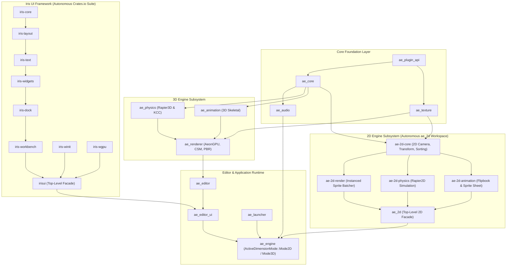
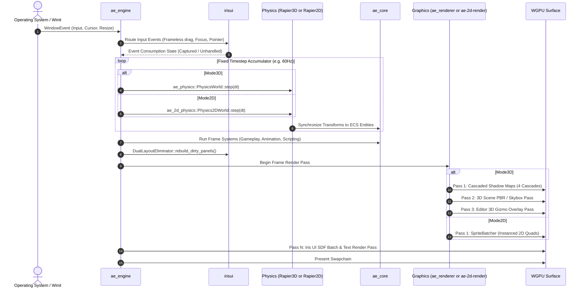

# Aeon Engine Architecture

This document describes the software architecture, crate dependency boundaries, execution lifecycle, and design invariants of Aeon Engine and the Iris UI framework.

---

## 1. Architectural Principles

1. **Zero Unsafe Mandate:**  
   The workspace strictly enforces `#![forbid(unsafe_code)]`. Memory safety, pointer validity, and thread safety are guaranteed at compile time through safe abstractions and standard library primitives.

2. **Unidirectional Dependency Flow:**  
   Circular dependencies between engine subsystems are prohibited. Higher-level modules consume lower-level primitives; lower-level primitives have zero awareness of consuming layers.

3. **Strict Domain Separation & Crates.io Independence (Engine vs. UI Framework):**  
   `irisui` is an autonomous, standalone desktop IDE framework engineered for independent publication to `crates.io`. It maintains zero dependencies on `ae_core` or engine runtime primitives. It implements a pure retained-mode widget tree architecture with fine-grained partial layout invalidation, completely decoupled from any game engine lifecycle. `ae_editor_ui` acts strictly as an external declarative consumer.

4. **Hot-Path Allocation Lock:**  
   Per-frame execution paths (`update`, `render`, `hit_test`, and physics steps) avoid heap allocations (`format!`, `String`, dynamic `Vec` expansion, or redundant `.clone()` operations) to maintain deterministic frame timing.

5. **Data-Driven & Explicit Type System:**  
   Subsystem state transitions and behavioral switches are driven by explicit Rust enums, mathematical quantities, and strongly typed ECS components. String-based heuristics (`name.contains(...)`) are prohibited.

---

## 2. Workspace Dependency Topology

The workspace is organized into modular crates with clear dependency boundaries:

### Dependency Rules:
- `ae_core` provides base ECS (`hecs`), component registration, and event bus with zero dependencies on 2D or 3D rendering pipelines.
- **2D vs. 3D Engine Isolation**: The 2D pipeline (`ae_2d/*`) and the 3D pipeline (`ae_renderer`, `ae_physics`, `ae_animation`) are strictly decoupled. 2D uses dedicated Rapier2D physics and instanced sprite batchers; 3D uses Rapier3D and multi-pass PBR/CSM pipelines. Both feed into `ae_engine` via `ActiveDimensionMode`.
- `irisui` has zero dependencies on any engine crate and publishes independently to `crates.io`.
- `ae_editor_ui` depends on `irisui` and `ae_editor`, but does not implement low-level UI infrastructure (dock trees, event dispatchers, or SDF shaders).

---

## 3. Subsystem Breakdown

### 3.1. `ae_core` (Core State & ECS)
- **Role:** Entity-Component-System primitives, state manager, serialization, and event bus.
- **ECS Engine:** Utilizes `hecs` for archetypal, cache-coherent component iteration.
- **Event Bus:** Decoupled `EngineEvent` channel for cross-system notification without tight structural coupling.
- **Serialization:** Strongly typed component registration providing deterministic binary (`bincode`) and text (`json`/`ron`) serialization for `.ae3d` scenes and `.aeprefab` assets.

### 3.2. `ae_physics` (Physics Simulation)
- **Role:** 3D rigid body dynamics, collision detection, and kinematic character control.
- **Integration:** Wraps Rapier3D.
- **Collider Cache:** Maintains a retained mapping (`entity_to_collider_scale`) to eliminate per-frame collider reconstruction when scales remain unchanged.
- **Kinematic Controller (KCC):** Step-handling, slope limits, and ground projection with fixed-timestep sub-stepping.

### 3.3. `ae_renderer` (3D Graphics & AeonGPU)
- **Role:** WGPU-based hardware-accelerated rendering pipeline.
- **Lighting & Materials:** Physically Based Rendering (PBR) using the Cook-Torrance GGX microfacet distribution with metallic-roughness workflow.
- **Shadow Mapping:** Directional Cascaded Shadow Maps (CSM) across 4 depth cascades with percentage-closer filtering (PCF).
- **Pipeline Architecture:** Retained bind group allocations, depth-stencil passes, forward+/clustered light evaluation, and procedural sky dome rendering.

### 3.4. `ae_2d` (Autonomous 2D Engine Subsystem)
The 2D engine is architecturally decoupled from the 3D pipeline into a modular 5-crate subsystem:

| Crate | Technical Function |
| :--- | :--- |
| `ae-2d-core` | 2D camera projections (orthographic), pixel-snapped 2D transforms, layer sorting keys (`SpriteSortKey`), and ECS components (`SpriteRenderer`). |
| `ae-2d-render` | High-throughput WGPU 2D pipeline: `Sprite2DPipeline`, `SpriteBatcher`, dynamic quad instancing, and texture atlas coordinate mapping. |
| `ae-2d-physics` | Rapier2D integration: 2D rigid bodies, 2D colliders, velocity resolution, and collision event propagation. |
| `ae-2d-animation` | 2D flipbook animation and sprite-sheet frame sequencer. |
| `ae_2d` | Unified top-level 2D facade exporting consolidated APIs and `ActiveDimensionMode`. |

When running in `ActiveDimensionMode::Mode2D`, the engine completely bypasses 3D PBR/CSM pipelines and 3D physics, dispatching exclusively to the dedicated 2D sprite batching and Rapier2D simulation loops.

### 3.5. `ae_editor` (Editor Tooling & Spatial Manipulation)
- **Role:** 3D viewport interaction, spatial raycasting, gizmos, and command management.
- **Gizmo Pipeline:** Mathematical raycast hit-testing against transformation axes (Translate, Rotate, Scale) with a 1.5-pixel hit threshold.
- **Command History:** Transactional Undo/Redo command stack for non-destructive scene modification.

### 3.6. `irisui` (Autonomous Crates.io Retained Desktop UI Framework)
`irisui` is an autonomous, general-purpose desktop IDE and windowing framework designed for standalone publication to `crates.io`. It maintains zero dependencies on Aeon Engine and can be consumed by any Rust desktop application.

Unlike immediate-mode UI libraries that reconstruct the entire widget tree and layout hierarchy every frame, `irisui` is engineered with a pure **retained-mode architecture**:
- **Persistent Generational Widget Trees:** Persistent widget nodes with generational IDs that preserve internal state (focus, text selection, scroll offsets) across frames without rebuilding.
- **Fine-Grained Invalidation Boundaries:** Instead of clearing or recalculating the entire layout tree on every frame (`tree.clear()` is prohibited in regular updates), `DualLayoutEliminator::rebuild_dirty_panels` performs $O(M)$ subtree updates, modifying only dirty leaf containers while keeping stable dock containers cached in Taffy.
- **GPU-Native Signed Distance Fields (SDF):** Analytically evaluates rounded rectangles, borders, shadows, and clip regions on the GPU via custom shaders, eliminating CPU mesh tessellation.
- **Autonomous IDE Window Chrome:** Native frameless window border hit-testing, safe double-click maximize/drag coordination (`WindowDragHost`), independent docking trees (`iris-dock`), and multi-tab layouts.

| Crate | Technical Function |
| :--- | :--- |
| `iris-core` | Retained widget tree, generational IDs, input event dispatch, layout invalidation tags. |
| `iris-layout` | Taffy integration for Flexbox and Grid computation. |
| `iris-text` | Text shaping, font metrics, multiline text layout using `glyphon` and `cosmic-text`. |
| `iris-widgets` | Declarative widget primitives (`Button`, `Slider`, `NumericDrag`, `InputBox`, `TreeList`). |
| `iris-dock` | Docking hierarchy (`DockTree`), panel tearing, splitters, tab reordering. |
| `iris-workbench`| IDE chrome: status bars, title bars, menu bars, and `DualLayoutEliminator`. |
| `iris-winit` | Winit event translation, frameless border resize, native window drag host. |
| `iris-wgpu` | GPU backend: Signed Distance Field (SDF) rounded rects, drop shadows, scissor stacks. |
| `irisui` | Top-level consolidated facade re-exporting the entire ecosystem for `crates.io`. |

### 3.7. `ae_editor_ui` (Editor Interface Views)
- **Role:** Connects editor state (`ae_editor`) and ECS data (`ae_core`) to declarative `UiScope` views.
- **Purity Rule:** Contains zero widget implementations, custom render passes, or manual hit-test arithmetic; operates strictly via declarative builders.

### 3.8. `ae_engine` & `ae_launcher` (Runtime Coordination)
- **`ae_launcher`:** Initial project launcher (Aeon Hub) for creating, configuring, and opening projects.
- **`ae_engine`:** Top-level application coordinator managing the OS event loop (`winit`), fixed-timestep accumulators, and render target swapchain management.

---

## 4. Execution Lifecycle (The Frame Highway)

The engine coordinates runtime systems through a deterministic frame loop, branching according to `ActiveDimensionMode`:

---

## 5. Concurrency & Memory Model

- **Thread Concurrency:** Heavy computation (e.g., asset decompression, shader pre-compilation, background scene loading) runs on thread pools, communicating with the main thread via lock-free channels or explicit message buffers.
- **No Hidden Global Singletons:** Global mutable singletons and interior-mutability escapes (such as unchecked `RefCell::borrow_mut()` across system boundaries) are prohibited. All mutations require explicit `&mut` access passed through the frame lifecycle.
- **Cache Locality:** Component arrays in `hecs` are stored in contiguous typed archetype storages to optimize CPU L1/L2 data cache hit rates during system iteration.

---

## 6. Verification & Quality Invariants

Continuous code quality across all workspace crates is enforced via automated tooling:

- **Compiler Lints:** Enforced `#![forbid(unsafe_code)]` on package roots.
- **Clippy Configuration (`clippy.toml`):** Zero warnings allowed (`-D warnings`). Prohibits `disallowed_types`, `redundant_clone`, `clone_on_copy`, `todo`, `unimplemented`, and debug macros in production code.
- **Formatting:** Enforced standard style via `cargo fmt --check`.
- **Automated Tests:** Unit tests verify mathematical invariants (transform matrix singular handling, gizmo pick raycast tolerances, and layout constraints) on every modification.

