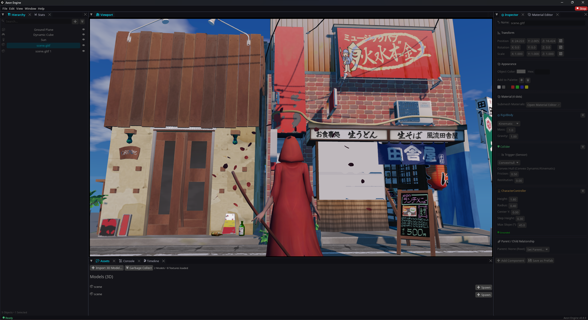

<div align="center">
  <picture>
    <source media="(prefers-color-scheme: dark)" srcset="../assets/icons/aeon_logo.svg">
    <source media="(prefers-color-scheme: light)" srcset="../assets/icons/aeon_logo_dark.svg">
    
  </picture>

  <h1>Aeon Engine</h1>

  <p>
    <a href="https://opensource.org/licenses/MPL-2.0"></a>
    <a href="https://github.com/aethelisdev/aeon-engine"></a>
    <a href="https://www.rust-lang.org/"></a>
    <a href="https://youtube.com/@Aeonengine"></a>
    <a href="https://instagram.com/aeonengine"></a>
    <a href="https://x.com/aeonengine"></a>
  </p>

  <p>
    <a href="../README.md">English</a> | <b>Türkçe</b> | <a href="README_ja.md">日本語</a> | <a href="README_zh.md">简体中文</a>
  </p>
</div>



## Aeon Engine Nedir?
Neredeyse tamamen safe Rust ile yazılmış, tam modüler bir oyun motorudur.

## Aeon Engine Neden Oluşturuldu?
Rust'ın güvenliğine ve performansına ilgi duyuyordum ve kendi oyunum için hafif, modüler bir motor istiyordum. Piyasadaki diğer motorlar ihtiyaçlarım için fazla ağırdı, hafif olanlar ise görsel olarak tatmin edici değildi. Bu yüzden hem görsel olarak çok kaliteli hem de hafif bir motor istiyordum. Bu yüzden kendi motorumu geliştirmeye başladım.

## Aeon Engine'in Amacı Nedir?
Geliştirme sürecinde belirlediğim hedefler şunlar:

 - **Modülerlik**: Motorun herhangi bir sistemini tamamen çıkarmak veya değiştirmek istersem çok fazla bağımlılığa maruz kalmadan rahatça değiştirebilme yeteneği 
 
 - **Kullanıcı tercihlerine göre adapte olan bir sistem**: Başlangıçta sistem hiçbir yük olmadan başlar ve render, fizik ve ses gibi modüller kullanıcının ihtiyaçlarına göre etkinleştirilir veya devre dışı bırakılır. Ayrıca düşük donanımlı bilgisayarlar için uzun vadede bu özellikleri RAM'den temizlemelerini sağlayan bir düğme eklemeyi düşünüyorum.
 
 - **Rust kodunu görsel programlamayla birleştirme (RedWrite)**: RedWrite, Rust kodunu görsel programlamayla eş zamanlı olarak birleştirmeyi amaçladığım bir sistemdir. Amacım, iki tarafta yapılan değişikliklerin birbirine anlık ve çift yönlü olarak yansımasıdır.
 
 - **Android cihazlarda editör olarak çalışabilme yeteneği**: Modüler, çalışan bir sistemde iyi sonuçlar ve yüksek performans elde edersem, Aeon motorumu Android cihazlarda doğrudan oyun üretebilen bir editör olarak geliştirerek oyun geliştirmenin Android cihazlarda mümkün olmadığı algısını kırmayı hedefliyorum.

## Mevcut Durum
Aeon Engine şu anda aktif olarak geliştirilmektedir.

Temel sistemlerin çoğu geliştirilmiş durumdadır, ancak API ve özellikler zamanla değişiklik gösterebilir.

## Nasıl Çalıştırılır
Makinenizde Rust kurulu olduğundan emin olun.

```bash
git clone https://github.com/aethelisdev/aeon-engine.git
cd aeon-engine

# Aeon Hub'ı başlat (Proje Yöneticisi & Başlatıcı)
cargo run --release

# veya Editörü doğrudan çalıştır:
cargo run -p ae_engine --release
```

## Tasarım Felsefesi
 
- **Modüler tasarım**
- **Basit editör**
- **Performans**
- **Safe Rust**
- **Gereksiz karmaşıklıktan kaçınmak**
- **Açık Kaynak**

## Editör Arayüzü — IrisUI

Aeon Engine'in editörü, Rust ile sıfırdan geliştirilmiş, GPU hızlandırmalı özel bir arayüz kütüphanesi olan IrisUI tarafından desteklenmektedir.

IrisUI; çoklu retained tree mimarisini, ayrıntılı değişiklik takibini (invalidation), Taffy tabanlı Flexbox/Grid yerleşimini ve GPU üzerinde çalışan SDF (Signed Distance Field) tabanlı çizim sistemini bir araya getirir.

### Temel Özellikler

- **Çoklu retained tree mimarisi**: Kalıcı widget ağaçları, korunan durum bilgileri ve ayrıntılı değişiklik takibi.
- **Artımlı yerleşim hesaplama**: Flexbox ve Grid desteği için Taffy entegrasyonu ve önbellekli ağaç senkronizasyonu.
- **GPU tabanlı SDF çizimi**: Yuvarlatılmış dikdörtgenler, kenarlıklar ve gölgeler, instanced quad'lar kullanılarak GPU üzerinde çizilir.
- **Toplu çizim (Batching)**: Ardışık UI öğeleri birleştirilerek çizim komutlarının ve CPU tarafındaki iş yükünün azaltılması hedeflenir.
- **Özel docking sistemi (iris-dock)**: Yerleştirilebilir paneller, sekmeli düzenler, sürükle-bırak ile panel taşıma ve bağımsız dock ağaçları.
- **Çoklu viewport desteği**: Bağımsız dock ağaçları, ayrılabilir editör panelleri ve ikincil pencereler.
- **Metin işleme**: Metin şekillendirme ve GPU tabanlı glif çizimi için cosmic-text ve glyphon kullanılır.

IrisUI; sahne hiyerarşisi, özellik denetleyicileri (inspector), varlık tarayıcısı (asset browser), performans panelleri ve bağımsız editör pencereleri dâhil olmak üzere Aeon Engine'in editör arayüzünün tamamında kullanılır.

## Lisans

Aeon Engine kaynak kodu **Mozilla Public License 2.0 (MPL 2.0)** altında lisanslanmıştır.

- **Bağımsız geliştiriciler ve oyun yaratıcıları**: Aeon Engine kullanarak ticari, kapalı kaynaklı oyunlar oluşturmakta özgürsünüz. Oyun mantığınızı veya oyun kaynak kodunuzu paylaşmanız gerekmez.
- **Motor modifikasyonları**: Ana motor dosyalarını değiştirirseniz, bu motor değişiklikleri MPL 2.0 lisansı altında paylaşılmalıdır.
- **Ticari ve kurumsal lisanslama**: Özel ticari lisanslama, özel motor çatalları veya kurumsal destek seçenekleri için AethelisDEV ile iletişime geçin.
